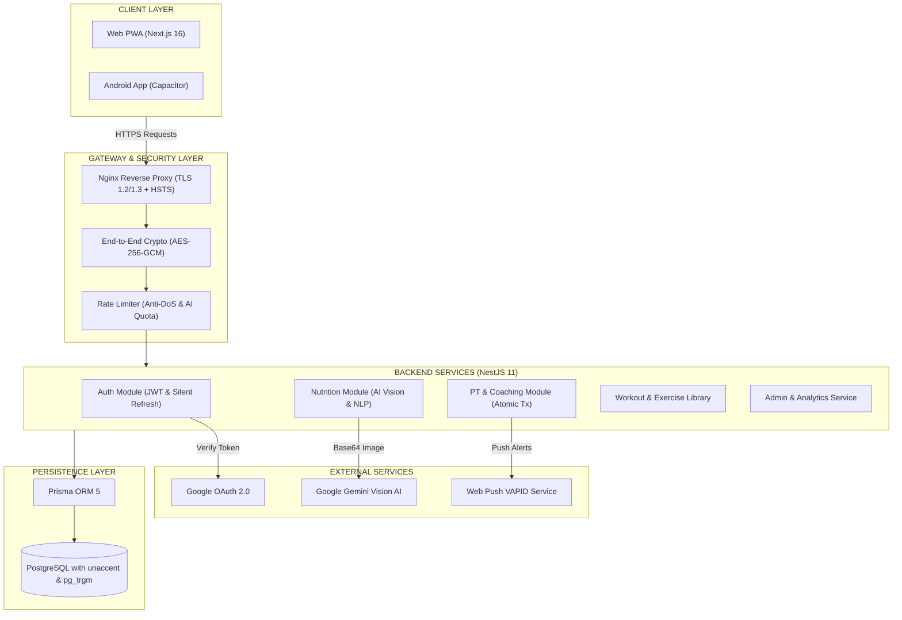

<div align="center">

# NutriCore — FitManagementPlatform
### Nền Tảng Quản Lý Dinh Dưỡng Thông Minh, Huấn Luyện PT & Thể Hình Toàn Diện

[](https://turbo.build/)
[](https://nextjs.org/)
[](https://nestjs.com/)
[](https://www.typescriptlang.org/)
[](https://www.postgresql.org/)
[](https://ai.google.dev/)
[](https://capacitorjs.com/)
[](https://www.docker.com/)

<p align="center">
  <b>NutriCore</b> là giải pháp công nghệ thể hình toàn diện, tích hợp <b>AI Computer Vision</b> nhận diện thực phẩm qua camera, bộ bóc tách <b>NLP ngôn ngữ tự nhiên tiếng Việt</b>, thuật toán tối ưu khẩu phần hệ sinh thái quản lý <b>Huấn luyện viên cá nhân </b>
</p>

[Tính năng nổi bật](#-tính-năng-nổi-bật) • [Kiến trúc hệ thống](#️-kiến-trúc-hệ-thống) • [Cấu trúc Monorepo](#-cấu-trúc-monorepo) • [Cài đặt & Khởi chạy](#-cài-đặt--khởi-chạy-nhanh) • [Bảo mật & An toàn dữ liệu](#️-bảo-mật--an-toàn-dữ-liệu) • [Kiểm thử tự động](#-kiểm-thử-tự-động--chất-lượng-mã-nguồn) • [Triển khai Production](#-triển-khai-production)

---
</div>

## Giới thiệu Tổng quan

**NutriCore (FitManagementPlatform)** giải quyết triệt để hai bài toán lớn nhất trong ngành Fitness & Dinh dưỡng cá nhân hóa:
1. **Đối với người tập (Học viên):** Xóa bỏ rào cản tính toán calo phức tạp. Người dùng chỉ cần chụp ảnh bữa ăn hoặc nói một câu tự nhiên (ví dụ: *"2 quả trứng gà và 1 bát cơm"*), hệ thống tự động bóc tách khối lượng và tính chỉ số dinh dưỡng (Calories, Protein, Carbs, Fat).
2. **Đối với Huấn luyện viên cá nhân (PT) & Phòng Gym:** Số hóa 100% quy trình vận hành: phát hành thư mời học viên qua mã QR, phân công lịch tập kèm ảnh hướng dẫn trực quan, chỉ định thực đơn ăn uống, điểm danh trừ buổi tập an toàn và theo dõi biến đổi thể hình học viên qua biểu đồ InBody.

---

## Tính năng Nổi bật

### 1. Nhận diện Bữa ăn Thông minh (Vision AI & NLP)
* **Google Gemini Multimodal Vision AI:** Nhận diện đĩa thức ăn từ camera hoặc ảnh tải lên, tự động nhận diện các món ăn và ước lượng số gram theo khẩu phần thực tế.
* **Xử lý Ngôn ngữ Tự nhiên tiếng Việt (Vietnamese NLP Engine):** Nhận diện giọng nói (Web Speech API) và bóc tách câu từ tự nhiên:
  * Tự động hiểu các đơn vị dân dã của người Việt: *"nửa bát/nửa chén"* (75g), *"2 quả/hột"* (100g), *"1 đĩa"* (200g), *"1 tô"* (350g), *"1 cốc/ly"* (200g).
  * Lọc sạch các từ nối liên kết (*"và", "với", "kèm", "cùng"*).
* **Tra cứu Tiếng Việt Không Dấu (Unaccent Search):** Tìm kiếm tức thì trong cơ sở dữ liệu `FoodLibrary` bất kể người dùng gõ có dấu hay không dấu.
* **Cơ chế Human-in-the-loop:** Người dùng luôn có thể xem trước và tinh chỉnh số gram trước khi lưu vào `MealLog`, đảm bảo độ chính xác dinh dưỡng 100%.

### 2. Thuật toán Lập Thực đơn Thông minh 
* **Tối ưu hóa đa mục tiêu (Discrete Solver & Heuristic):** Tự động phân bổ món ăn vào các bữa (Sáng, Trưa, Tối, Phụ) khớp với mục tiêu TDEE, Calo và cân bằng tỷ lệ Macro:
  $$\text{Tỷ lệ đạt chuẩn: } \ge 100\% \text{ Protein}, \ge 95\% \text{ Carbs}, \ge 90\% \text{ Fat}$$
* **Bộ lọc Dị ứng & Bệnh lý chuyên sâu:** Tự động loại trừ thực phẩm gây dị ứng (hải sản, đậu phộng, gluten, lactose, trứng, đậu nành...).

### 3. Hệ sinh thái Huấn luyện viên Cá nhân 
* **Mời học viên qua QR Code & Deep Link:** PT tùy chọn linh hoạt số buổi tập của gói (12, 16, 24, 36 buổi hoặc số buổi bất kỳ). Học viên chỉ cần quét mã QR hoặc click link là tự động liên kết với PT.
* **Lịch tập tương tác (PT Schedule):** Giao diện lịch dạng lưới tháng/tuần/ngày, cho phép PT xếp lịch tập, gắn bài tập kèm hình ảnh kỹ thuật minh họa và thực đơn dinh dưỡng.
* **Điểm danh an toàn (Atomic Check-in):** Trừ buổi tập qua Database Transaction nguyên tử, chống gian lận hoặc bấm đúp trừ trùng lặp buổi tập.
* **Biểu đồ InBody chuyên nghiệp:** Trực quan hóa diễn biến Cân nặng (Weight), Tỷ lệ mỡ (Body Fat) và Khối lượng cơ (Muscle Mass) theo trục thời gian thực.
* **Transformation Journey Slider:** Thanh trượt so sánh ảnh chụp vóc dáng trước và sau lộ trình tập luyện.

### 4. Ứng dụng Đa nền tảng (Web PWA & Android Native)
* **Web PWA:** Hỗ trợ Service Worker, cài đặt trực tiếp lên màn hình chính (A2HS), hỗ trợ Web Push Notification thông báo giờ tập và nhắc nhở uống nước.
* **Capacitor Android:** Đóng gói nguyên bản (Native APK) với cấu hình quyền Camera, Microphone và Storage tối ưu cho thiết bị Android.

---

## Kiến trúc Hệ thống



---

## Cấu trúc Monorepo

NutriCore được quản lý theo mô hình Monorepo tối ưu hóa với **Turborepo** và **npm workspaces**:

```
FitManagementPlatform/
├── apps/
│   ├── web/                     # Ứng dụng Frontend Next.js 16 (App Router, Tailwind CSS, SWR, Capacitor)
│   │   ├── app/                 # Các trang giao diện (Home, Training, Add-Meal, PT, Admin, Profile, Login)
│   │   ├── api/                 # Axios Client với Interceptor tự động Refresh Token & Mã hóa E2E
│   │   ├── hooks/               # SWR custom hooks quản lý Server State & Caching
│   │   ├── utils/               # Tiện ích bóc tách NLP tiếng Việt, Crypto, Toast, Push Notifications
│   │   └── android/             # Mã nguồn dự án Android Capacitor nguyên bản
│   │
│   └── backend/                 # Ứng dụng Backend NestJS 11 REST API
│       └── src/
│           ├── common/          # Middleware mã hóa, Logger Masking, Exception Filters, Security Guards
│           └── modules/         # Các Module nghiệp vụ (Auth, Nutrition, PT, Workout, Admin, Users)
│
├── packages/
│   ├── db/                      # Prisma ORM Schema, Database Migrations & Seeding
│   ├── types/                   # Contracts, Interfaces & DTOs dùng chung toàn hệ sinh thái
│   ├── ui/                      # Bộ thư viện UI Components tái sử dụng
│   ├── eslint-config/           # Cấu hình ESLint tiêu chuẩn cho Monorepo
│   └── typescript-config/       # Cấu hình tsconfig nền tảng
│
├── deploy/                      # Cấu hình Production (Nginx HTTPS Reverse Proxy, Dockerfile)
├── scripts/                     # Shell & PowerShell scripts tự động Backup / Restore PostgreSQL
└── turbo.json                   # Pipeline build & cache của Turborepo
```

---

## Công nghệ Sử dụng

| Tầng | Công nghệ / Thư viện | Mô tả |
| :--- | :--- | :--- |
| **Frontend** | `Next.js 16 (React 19)` | App Router, Server/Client Components, tối ưu hóa SEO & Rendering |
| | `Tailwind CSS v4` | Hệ thống styling hiện đại, linh hoạt, hỗ trợ Dark Mode |
| | `SWR 2.5` | Quản lý Server State, Stale-While-Revalidate caching, Deduplication |
| | `Framer Motion` | Hiệu ứng chuyển động giao diện mượt mà |
| | `Web Speech API` | Nhận diện giọng nói tiếng Việt trực tiếp trên trình duyệt |
| | `Capacitor 8` | Đóng gói ứng dụng di động Android Native |
| **Backend** | `NestJS 11` | Enterprise Node.js Framework, kiến trúc Module hóa chặt chẽ |
| | `Prisma ORM 5` | Type-safe ORM kết nối cơ sở dữ liệu PostgreSQL |
| | `Web Crypto API & bcryptjs` | Mã hóa mật khẩu, tạo chữ ký số và mã hóa đối xứng AES-GCM |
| | `@nestjs/throttler` | Rate limiting ngăn chặn Brute-force & lạm dụng API |
| **AI / NLP** | `Google Gemini Vision` | Nhận diện thị giác đĩa thức ăn và ước tính trọng lượng |
| | `Vietnamese NLP Parser` | Thuật toán bóc tách khẩu phần ăn dân dã Việt Nam |
| **Database** | `PostgreSQL 15+` | Hệ quản trị cơ sở dữ liệu quan hệ, tích hợp `unaccent` |
| **DevOps & QA**| `Docker & Docker Compose`| Container hóa toàn bộ hệ thống sẵn sàng cho Production |
| | `Nginx & Let's Encrypt` | Reverse Proxy, SSL/TLS 1.2/1.3, HSTS tự động gia hạn |
| | `Jest, Vitest, Playwright` | Bộ 3 kiểm thử: Backend Unit, Web Unit và End-to-End |

---

## Cài đặt & Khởi chạy Nhanh

### Yêu cầu Tiên quyết
* **Node.js**: Phiên bản `>= 18.0.0` (khuyến nghị Node 20 LTS)
* **npm**: Phiên bản `>= 10.0.0`
* **PostgreSQL**: Đang chạy trên máy local hoặc qua Docker container

### Bước 1: Clone kho mã nguồn & Cài đặt Dependencies
```bash
git clone https://github.com/your-username/FitManagementPlatform.git
cd FitManagementPlatform

# Cài đặt toàn bộ thư viện trong Monorepo
npm install
```

### Bước 2: Thiết lập Biến Môi trường (Environment Variables)

**1. Cấu hình Backend (`apps/backend/.env`):**
```env
PORT=3100
NODE_ENV=development
CLIENT_URL= Đường dẫn localhost của bạn

# Kết nối PostgreSQL
DATABASE_URL="Database của bạn"

# Bảo mật JWT (tối thiểu 32 ký tự)
JWT_SECRET=your-secure-jwt-secret-key-at-least-32-chars

# Khóa mã hóa Payload AES-256-GCM (64 hex chars - chia sẻ chung với Frontend)
API_ENCRYPTION_KEY=0123456789abcdef0123456789abcdef0123456789abcdef0123456789abcdef

# Khóa Google Gemini Vision AI
GEMINI_API_KEY=your-gemini-api-key

# Google OAuth (Tùy chọn đăng nhập nhanh)
GOOGLE_CLIENT_ID=your-google-client-id.apps.googleusercontent.com
GOOGLE_CLIENT_SECRET=your-google-client-secret
```

> **Mẹo tạo mã Hex 64 ký tự:** Chạy lệnh:  
> `node -e "console.log(require('crypto').randomBytes(32).toString('hex'))"`

**2. Cấu hình Frontend (`apps/web/.env.local`):**
```env
NEXT_PUBLIC_API_URL=http://localhost:3100
NEXT_PUBLIC_API_ENCRYPTION_KEY=0123456789abcdef0123456789abcdef0123456789abcdef0123456789abcdef
NEXT_PUBLIC_GOOGLE_CLIENT_ID=your-google-client-id.apps.googleusercontent.com
```

### Bước 3: Đồng bộ Cơ sở dữ liệu Prisma
```bash
npm run db:push
npm run db:generate
```

### Bước 4: Khởi chạy môi trường Phát triển
```bash
npm run dev
```
Truy cập trình duyệt tại địa chỉ: **`http://localhost:3000`**

---

## Kiểm thử Tự động & Chất lượng Mã nguồn

Dự án duy trì bộ kiểm thử toàn diện nhằm đảm bảo tính ổn định tuyệt đối:

```bash
# 1. Kiểm tra Lỗi Kiểu Dữ liệu (Strict Type-Check trên toàn Monorepo)
npm run check-types

# 2. Kiểm tra Quy chuẩn Code (ESLint với quy tắc Zero-Warning)
npm run lint

# 3. Chạy toàn bộ Unit Tests (Jest cho Backend, Vitest cho Web Utils)
npm test

# 4. Chạy End-to-End Tests với Playwright (Giao diện & Luồng nghiệp vụ)
npm run test:e2e
```

* **Backend Unit Tests (Jest):** 46 tests kiểm thử toàn diện Logic cân bằng Macro, Discrete Meal Solver, bảo mật Crypto, xác thực Auth và giao dịch PT Check-in.
* **Web Unit Tests (Vitest):** 16 tests kiểm thử thuật toán tách khẩu phần tiếng Việt, mã hóa Client và quy đổi dinh dưỡng.

---

### Tóm tắt lệnh Triển khai nhanh:
```bash
docker compose -f deploy/docker-compose.prod.yml up -d --build

bash scripts/init-letsencrypt.sh

bash scripts/backup-db.sh
```

---

## Đội ngũ Phát triển & Đóng góp

* **Sản phẩm:** NutriCore Team
* **Tiêu chuẩn mã nguồn:** Clean Code, Conventional Commits, TypeScript Strict Mode & Tech Lead Architecture Standards.

---

<div align="center">
  <sub>Xây dựng với sự tâm huyết dành cho cộng đồng yêu thể hình và lối sống khỏe mạnh 🇻🇳</sub>
</div>
